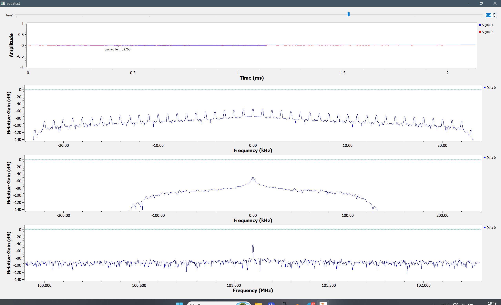
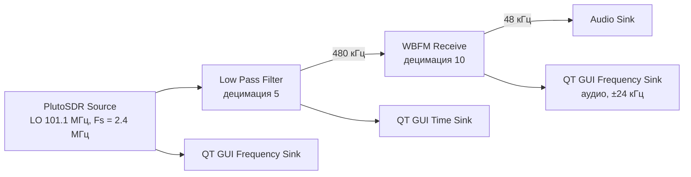
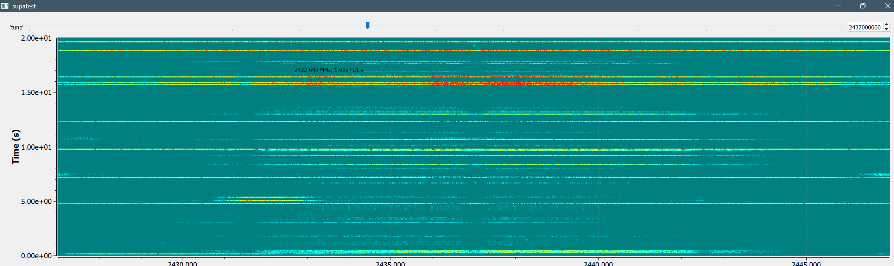
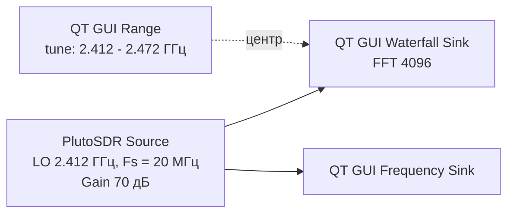
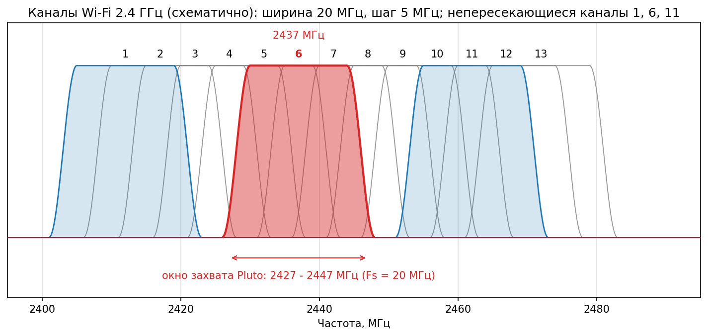

# Недели 1-2 (08.09 - 20.09): GNU Radio, приём на ADALM-Pluto

**Содержание**
* [Занятие 1. FM-приёмник (08.09)](#занятие-1-fm-приёмник-0809)
* [Занятие 2. Водопад 2.4 ГГц, пакеты Wi-Fi (15.09)](#занятие-2-водопад-24-ггц-пакеты-wi-fi-1509)
* [Источники](#источники)

---

## Занятие 1. FM-приёмник (08.09)

**Задача:** собрать в GNU Radio FM-приёмник на PlutoSDR и поймать радиостанцию.

**Что сделал:** схема `PlutoSDR Source → Low Pass Filter → WBFM Receive → Audio Sink`, плюс Frequency Sink, Time Sink и ползунок `tune` (88.7-110.1 МГц) для контроля.

| Блок | Параметры |
|------|-----------|
| PlutoSDR Source | URI `192.168.2.1`, LO 101.1 МГц, Sample Rate 2.4 МГц |
| Low Pass Filter | децимация 5, Cutoff 100 кГц, Transition Width 50 кГц, окно Kaiser |
| WBFM Receive | Quadrature Rate 480 кГц, Audio Decimation 10 |
| Audio Sink | 48 кГц |

**Что не получалось:** сначала в динамиках был только шум. Подбирал параметры фильтра, усиление и положение антенны, после этого звук пошёл.

**Результат:** звук станции на 101.1 МГц. На скриншоте сверху вниз: сигнал во времени, спектр после WBFM (±24 кГц), спектр после LPF (±240 кГц), полоса 100-102 МГц с узким пиком станции на 101.1 МГц.

Схема цепочки и формулы

Частота дискретизации после децимации:

$$F_{s}^{out} = \frac{F_{s}^{in}}{D}, \qquad \frac{2.4\ \text{МГц}}{5} = 480\ \text{кГц}, \qquad \frac{480\ \text{кГц}}{10} = 48\ \text{кГц}$$

FM-сигнал и его ширина по правилу Карсона:

$$s(t) = A_c \cos\!\left(2\pi f_c t + 2\pi k_f \int_0^t m(\tau)\,d\tau\right), \qquad B \approx 2(\Delta f + f_m)$$

Для вещательного FM $\Delta f = 75$ кГц, $f_m = 15$ кГц, откуда $B \approx 180$ кГц. Это укладывается в полосу ±100 кГц фильтра Cutoff 100 кГц.

---

## Занятие 2. Водопад 2.4 ГГц, пакеты Wi-Fi (15.09)

**Задача:** переделать приёмник под диапазон 2.4 ГГц и увидеть на водопаде трафик своей Wi-Fi сети.

**Что сделал:**
1. Переделал FM-схему: убрал цепочку FM, оставил `PlutoSDR Source → QT GUI Waterfall Sink` (FFT 4096) и Frequency Sink.
2. Параметры источника: LO 2.412 ГГц, Sample Rate 20 МГц, Gain Manual 70 дБ, URI `192.168.3.1`. Ползунок `tune` 2.412-2.472 ГГц, шаг 5 МГц.
3. В Waterfall Sink задал Center Frequency = `tune`, Bandwidth = `samp_rate`, Intensity Min -15, Max -75.
4. Выставил `tune` = 2437 МГц (канал 6) и запустил видео в своей сети, чтобы появился трафик.

**Проблемы и решения:**
* `RuntimeError: Unable to create context` при запуске. Устройство не отвечало по `192.168.2.1`, перешёл на `192.168.3.1`.
* Первый водопад на 2442 МГц был засвечен, пакетов не видно. После настройки шкалы Intensity фон стал ровным, а сильные участки выделились цветом.

**Результат:** на водопаде видны пакеты моей сети: горизонтальные полосы шириной около 20 МГц, самые мощные участки красные.

Схема, формулы и каналы Wi-Fi

Центр канала Wi-Fi 2.4 ГГц и разрешение водопада:

$$f_c = 2407 + 5n\ \text{МГц}, \quad n = 6:\ f_c = 2437\ \text{МГц}, \qquad \Delta f_{bin} = \frac{F_s}{N_{FFT}} = \frac{20\ \text{МГц}}{4096} \approx 4.9\ \text{кГц}$$

Канал шириной около 20 МГц занимает 2427-2447 МГц и целиком попадает в полосу захвата Pluto.

---

## Источники

* [Wikipedia, List of WLAN channels](https://en.wikipedia.org/wiki/List_of_WLAN_channels)
* [Wikimedia Commons, схема каналов 2.4 ГГц](https://commons.wikimedia.org/wiki/File:2.4_GHz_Wi-Fi_channels_(802.11b,g_WLAN).svg)
* [MathWorks, WLAN Radio Frequency Channels](https://www.mathworks.com/help/wlan/gs/wlan-radio-frequency-channels.html)
