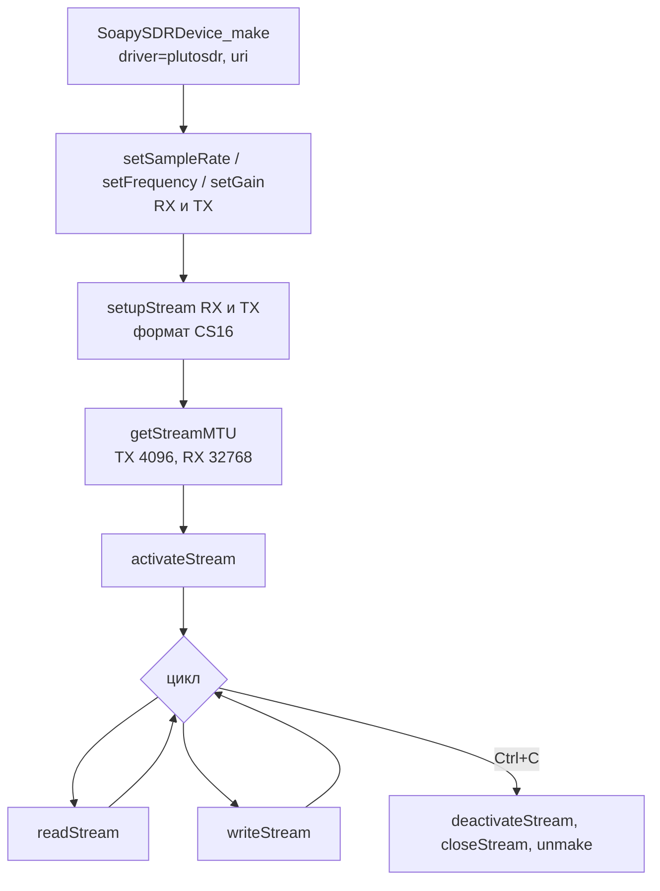

# Неделя 3 (21.09 - 27.09): SoapySDR и libiio

**Содержание**
* [Занятие 3. Инициализация Pluto через SoapySDR (22.09)](#занятие-3-инициализация-pluto-через-soapysdr-2209)

---

## Занятие 3. Инициализация Pluto через SoapySDR (22.09)

**Задача:** перейти от GNU Radio к работе с Pluto из кода на C: открыть устройство, настроить потоки, получить IQ-отсчёты из буфера. Самостоятельно: установить библиотеки, собрать проект с `CMakeLists.txt`, разобраться, как формируются сэмплы на передачу и приём.

**Что сделал:** разобрал пример преподавателя `soapy_pluto_sdr_timestamp.c` (репозиторий `sdrLessons`) и структуру проекта: `include/`, `lib/`, `src/`. Порядок работы с устройством:
1. `SoapySDRDevice_make` с аргументами `driver=plutosdr`, `uri`, `direct`, `timestamp_every`.
2. `setSampleRate`, `setFrequency`, `setGain` отдельно для RX и TX.
3. `setupStream` для RX и TX в формате CS16.
4. `getStreamMTU`: размеры буферов.
5. `activateStream`, цикл `readStream` / `writeStream`, в конце `deactivateStream`, `closeStream`, `unmake`.

**Результат:** устройство открывается, потоки создаются, MTU: TX 4096 отсчётов, RX 32768 отсчётов.

**Файлы:** [`code/reference_soapy_pluto_sdr_timestamp.c`](../code/reference_soapy_pluto_sdr_timestamp.c) (пример преподавателя).

Схема вызовов и формулы

Отсчёт хранится как комплексное число из двух 16-битных целых (от -32768 до 32767), длительность буфера определяется его размером и частотой дискретизации:

$$x[n] = I[n] + jQ[n], \qquad T_{buf} = \frac{N}{F_s}$$

При $F_s = 1$ МГц буфер RX из 32768 отсчётов длится около 32.8 мс, буфер TX из 4096 отсчётов около 4.1 мс.

