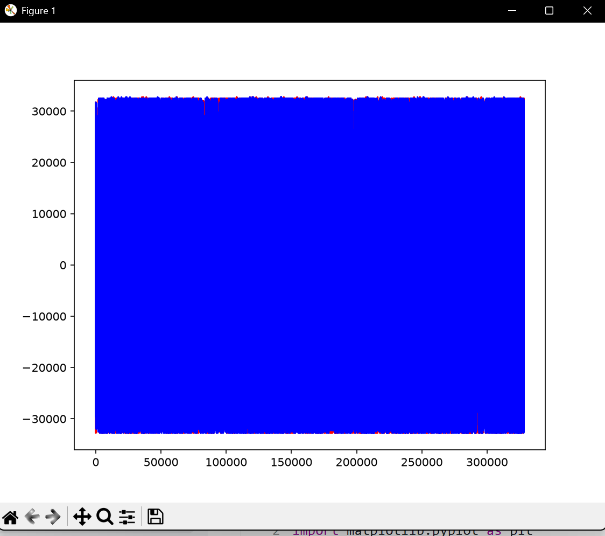
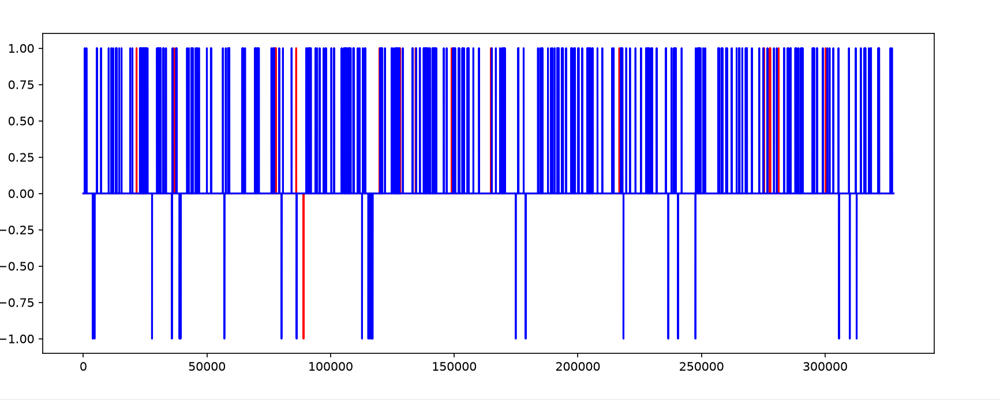
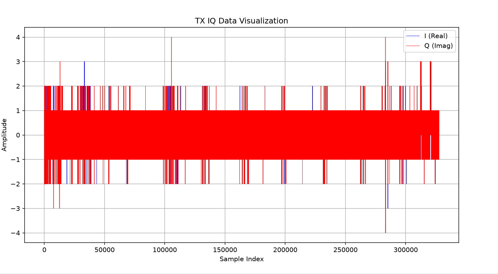
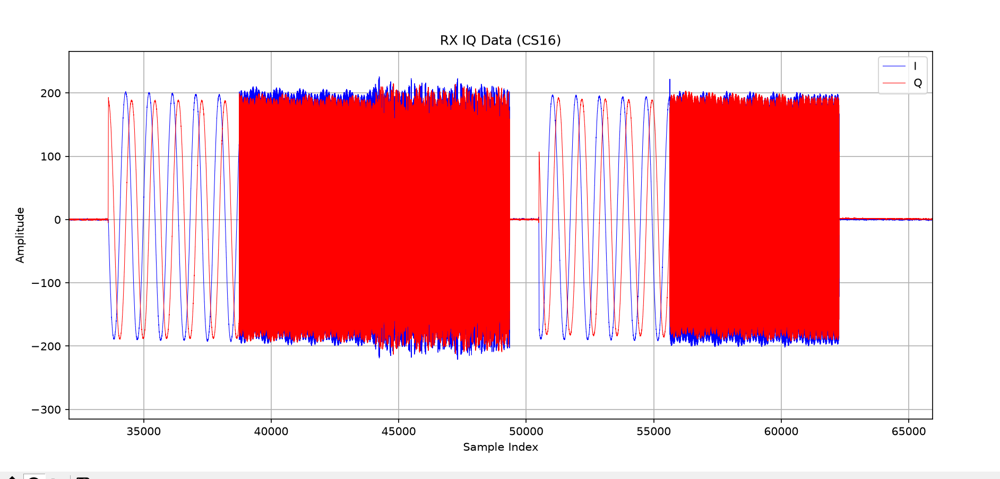
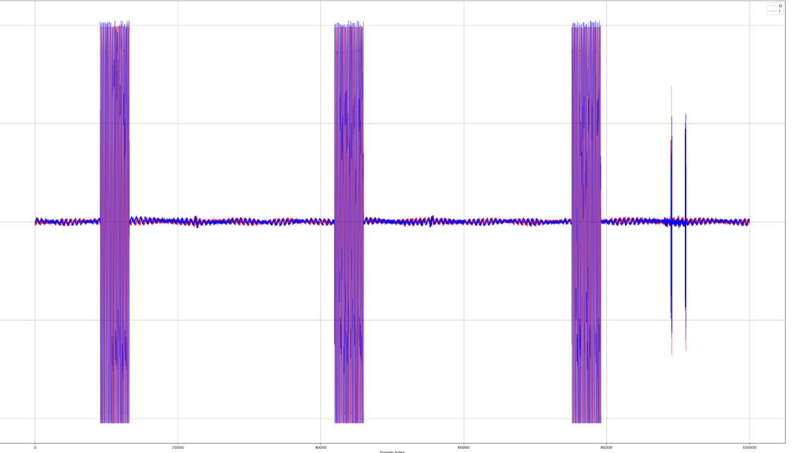
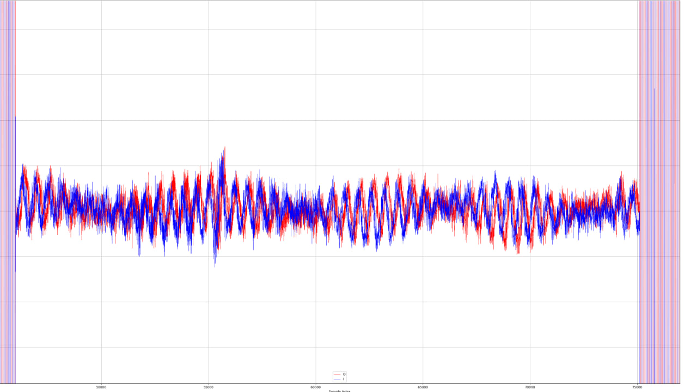
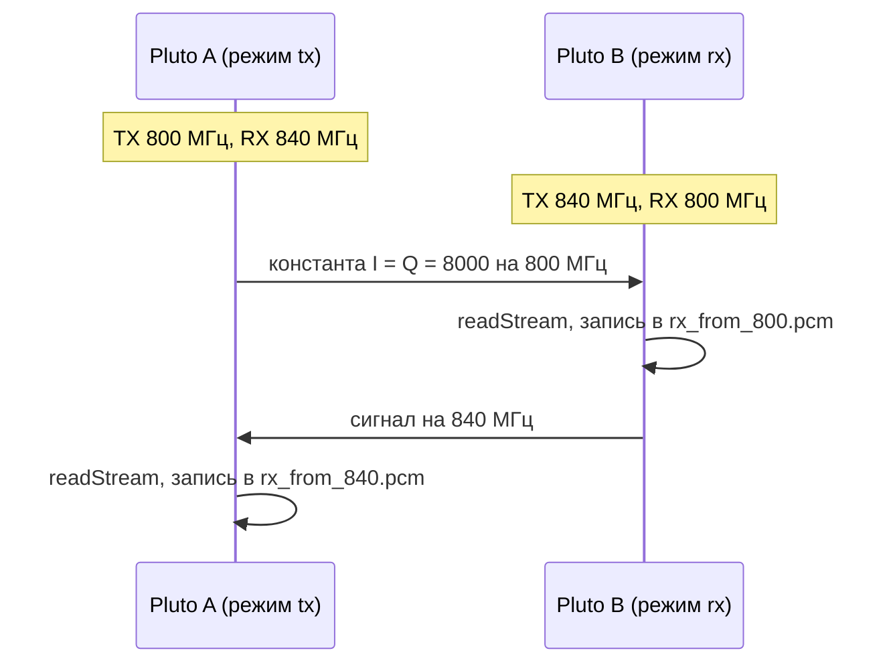
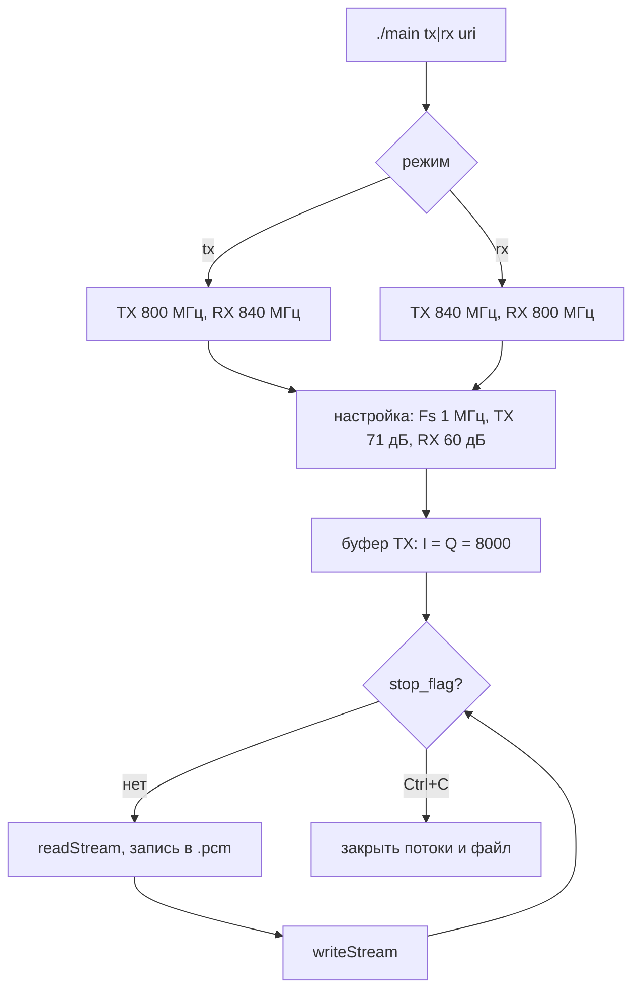
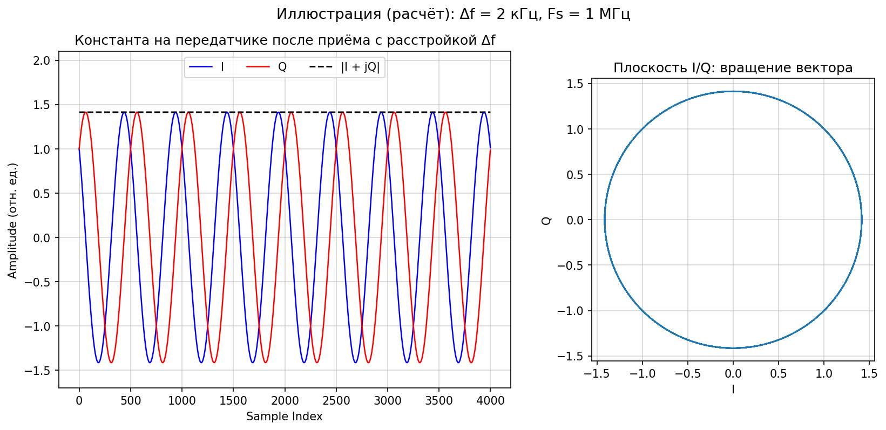

# Недели 4-6 (28.09 - 18.10): IQ-отсчёты, два Pluto

**Содержание**
* [Занятие 4. Приём IQ-отсчётов (29.09)](#занятие-4-приём-iq-отсчётов-2909)
* [Занятие 5. Среда и проект для двух Pluto (06.10)](#занятие-5-среда-и-проект-для-двух-pluto-0610)
* [Занятие 6. Приём и передача между двумя Pluto (13.10)](#занятие-6-приём-и-передача-между-двумя-pluto-1310)
* [Проблемы и решения](#проблемы-и-решения)
* [Запуск](#запуск)

---

## Занятие 4. Приём IQ-отсчётов (29.09)

**Задача:** принять IQ-отсчёты из буфера, записать в файл и построить график.

**Что сделал:** приём на 800 МГц, Fs 1 МГц, формат CS16, буфер 32768 отсчётов. Замерил RMS на 10 буферах при разном усилении, отсчёты записал в `.pcm` и построил графиком (`scripts/plot_original.py`).

| RX gain | RMS | Диапазон I/Q |
|---------|-----|--------------|
| 0 дБ | ≈ 0.02 | -1...1 |
| 40 дБ | ≈ 0.4 | -4...4 |

**Результат:** графики по порядку работы.

| Что видно | График |
|-----------|--------|
| Амплитуда упирается в предел int16 (около ±32 700) |  |
| Gain 0 дБ: только 0 и ±1, шумовой уровень |  |
| Gain 40 дБ: в основном ±1, выбросы до ±4 |  |
| Принятый сигнал: участки синусоиды и плотные пачки около ±200 |  |

<details>
<summary>Формула RMS</summary>

$$\text{RMS} = \sqrt{\frac{1}{N}\sum_{n=0}^{N-1}\left(I_n^2 + Q_n^2\right)}$$

</details>

---

## Занятие 5. Среда и проект для двух Pluto (06.10)

**Задача:** подключить два Pluto, один сделать приёмником, второй передатчиком.

**Что сделал:**
1. Среда: Bazzite, контейнер distrobox `sdr-build`. SoapySDR, libiio и SoapyPlutoSDR собраны из исходников.
2. Два Pluto по USB найдены через `SoapySDRUtil --find` (`usb:3.4.5`, `usb:3.5.5`).
3. Проект `pluto_dual` на CMake с тремя программами:

| Программа | Что делает |
|-----------|------------|
| `pluto_tx` | передаёт треугольный сигнал с таймстемпами |
| `pluto_rx` | принимает, пишет в `audio_rx.pcm` |
| `loopback` | проверка на одном устройстве |

**Результат:** передача и приём работают, все три программы собираются.

---

## Занятие 6. Приём и передача между двумя Pluto (13.10)

**Задача:** передать сигнал с одного Pluto на другой и принять его.

**Что сделал:** объединил программы в один бинарь [`code/bazzite_main/main.c`](../code/bazzite_main/main.c) с режимом при запуске. Обе платы одновременно передают и принимают на разных частотах:

| Режим | TX | RX | Файл с записью |
|-------|----|----|----------------|
| `tx` | 800 МГц | 840 МГц | `rx_from_840.pcm` |
| `rx` | 840 МГц | 800 МГц | `rx_from_800.pcm` |

Параметры: Fs 1 МГц, TX gain 71 дБ, RX gain 60 дБ. Передаётся константа I = Q = 8000, то есть прямоугольный импульс в базовой полосе:

```c
const int16_t dc_val = 8000;
for (size_t i = 0; i < tx_mtu; i++) {
    tx_buf[2*i]     = dc_val;   // I
    tx_buf[2*i + 1] = dc_val;   // Q
}
```

Принятый файл (81 264 640 отсчётов) строится скриптом [`scripts/plot_final.py`](../scripts/plot_final.py): I, Q и огибающая в окне 100 000 отсчётов из середины записи.

**Результат:** на графике IQ три пачки прямоугольных импульсов, которые ложатся на синусоиду. На ранней версии (gain 40/30 дБ) RMS на принимающей плате был около 260, на другой около 2.2.




**Почему синусоида.** Гетеродины двух плат стоят на чуть разных частотах. Из-за расстройки $\Delta f$ константа в базовой полосе на приёмнике вращается на частоте биений, а огибающая остаётся постоянной.

<details>
<summary>Диаграммы и формулы</summary>





$$r[n] = g\,A\,(1 + j)\,e^{\,j 2\pi \Delta f\, n / F_s}, \qquad I[n] = \sqrt{2}\,gA\cos\!\left(\frac{2\pi \Delta f\, n}{F_s} + \frac{\pi}{4}\right), \qquad |r[n]| = \sqrt{2}\,gA$$

Здесь $\Delta f = f_{TX} - f_{LO}$, $g$ учитывает потери в канале. Иллюстрация (расчёт, $\Delta f = 2$ кГц):



</details>

---


## Проблемы и решения

| Занятие | Ошибка | Причина и решение |
|---------|--------|-------------------|
| 5 | `timestamp_every only currently supported with direct mode` | нужен режим direct. Добавил в аргументы устройства `direct=1` |
| 5 | `'sqrt' was not declared` | не подключён `math.h`. Добавил `#include <math.h>` и ключ `-lm` |
| 5-6 | `Unable to claim interface ... Device or resource busy` | устройство занято прошлым запуском. `pkill -9 -f ./main`, пауза, повторный `--find` |
| 5-6 | `no device context found` | URI устарел, после переподключения он меняется (`usb:3.4.5` -> `usb:3.9.5`). Брал актуальный URI из `--find` |
| 6 | `jump to label crosses initialization` | переменные объявлены между `goto` и меткой. Переписал блок очистки |
| 6 | график 81 млн отсчётов строится очень долго | `plot_final.py` читает файл через `numpy.fromfile` и рисует только окно |

---

## Запуск

Сборка в контейнере `sdr-build`:
```
g++ main.c -o main $(pkg-config --cflags --libs SoapySDR) -lm
```
Два терминала (URI из `SoapySDRUtil --find`):
```
./main rx usb:3.x.5
./main tx usb:3.y.5
```
Остановка: Ctrl+C (при этом сохраняется `.pcm`). График: `python3 scripts/plot_final.py`.
