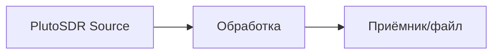

# Занятие N. Тема (ДД.ММ)

> Скопируйте этот файл в `reports/lesson-NN-тема/README.md` и заполняйте.
> Пункт «Что не получилось» — обязательный, пустым его оставлять нельзя.

**Дата:** ДД.ММ.ГГГГ
**Стенд:** ADALM-Pluto (1 или 2 шт.), GNU Radio / SoapySDR + libiio, ОС и контейнер
**Код занятия:** `src/…`, `scripts/…`
**Артефакты:** `../assets/…`

---

## 1. Задача

Что задано преподавателем и что я сам себе добавил сверх этого. Одна-две строки, конкретно.

## 2. План

Как собирался делать (3–5 пунктов). План потом сравнивается с реальностью — это и есть прогресс.

## 3. Ход работы

Своими словами, по шагам, с параметрами. Каждый шаг: что сделал → что увидел → какой вывод.
Параметры прибора указывать явно (LO, Fs, gain, BW, формат отсчётов, размер буфера, URI).

```text
шаг 1: …
шаг 2: …
```

При необходимости — схема/диаграмма:



## 4. Что не получилось

Самый важный раздел. Формат: **симптом → гипотеза → проверка → причина → решение**.
Сюда же: сколько времени ушло, что попробовал впустую, что до сих пор не работает
и почему (с гипотезой).

| Симптом | Что пробовал | Причина | Решение |
|---|---|---|---|
|  |  |  |  |

## 5. Результат

Числа, таблицы, графики — то, что можно проверить.

| Параметр | Значение |
|---|---|
|  |  |


*Параметры съёмки: LO = …, Fs = …, gain = …, размер окна = …*

## 6. Вывод

Что понял про физику/протокол/инструмент. 2–4 строки, без общих слов.
Если уместно — формула и подстановка своих чисел:

$$ \Delta f_{bin} = \frac{F_s}{N_{FFT}} $$

## 7. Артефакты

- код: [`src/…`](../../src/…)
- скрипты: [`scripts/…`](../../scripts/…)
- картинки: `../assets/…`
- коммиты: `git log --oneline -- src/…`

## 8. Что дальше

Конкретный следующий шаг (не «продолжить работу», а «добавить подсчёт потерянных буферов»).

## 9. Источники

Ссылки на документацию, пример из `examples/`, статьи.
Если чужой код разбирал или использовал как основу — указать явно, что именно взято.
