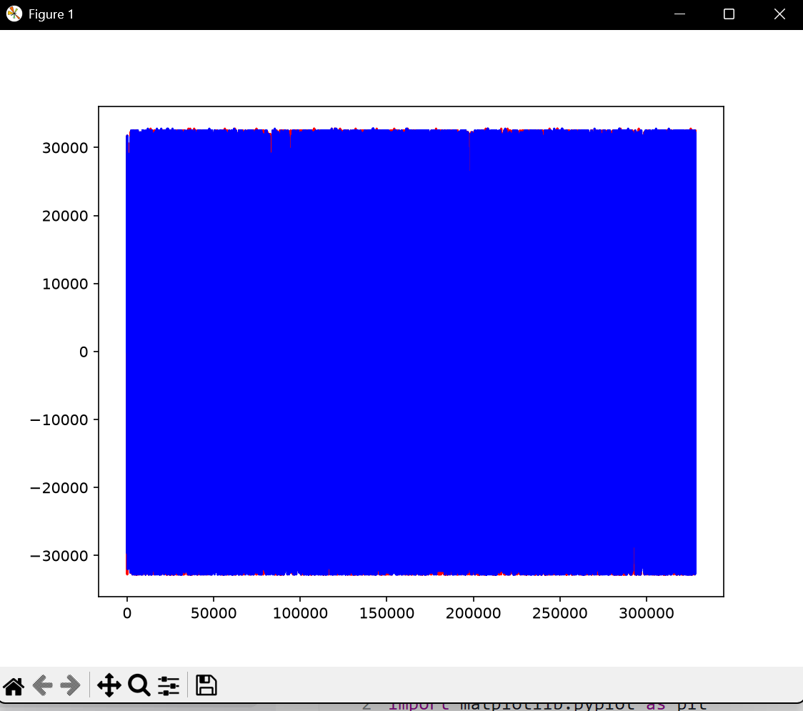
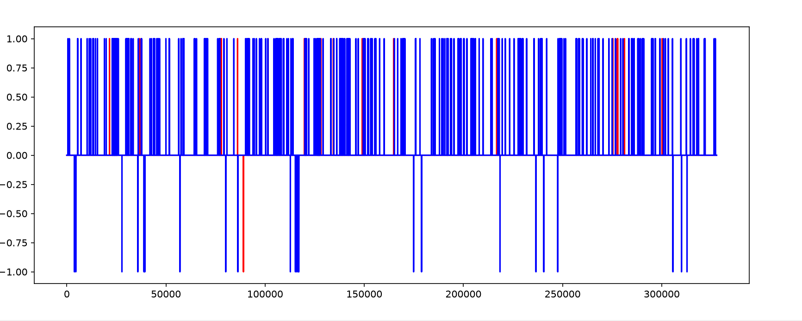
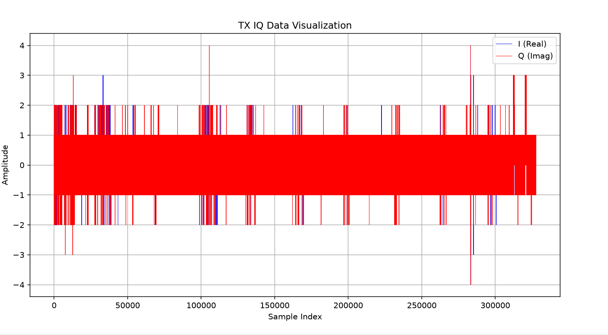
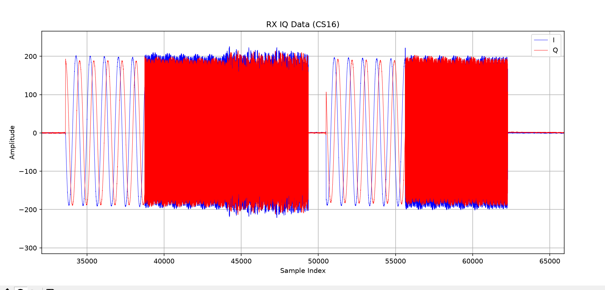
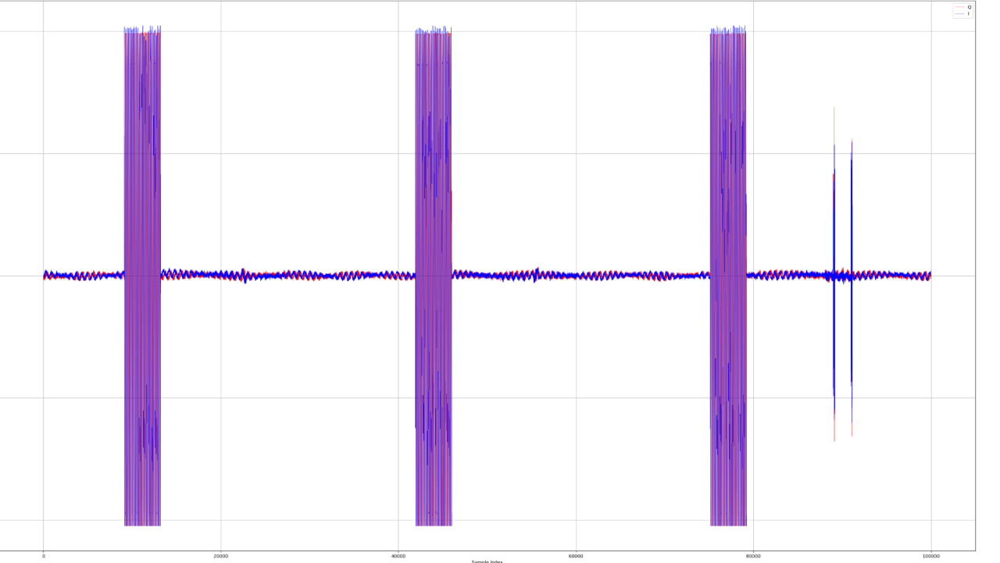
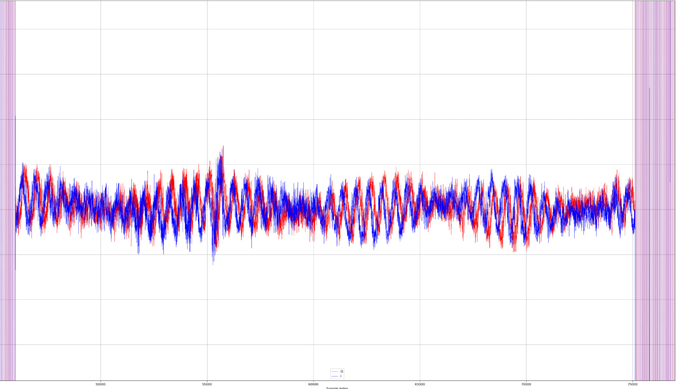
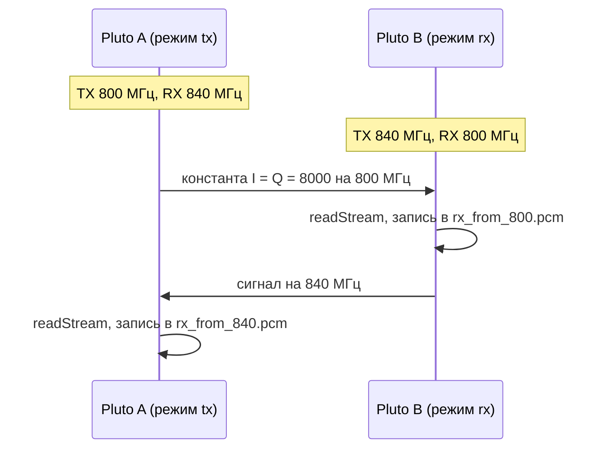
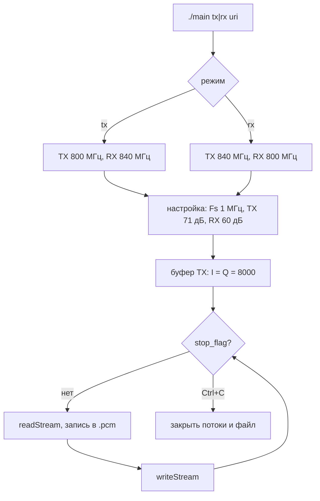
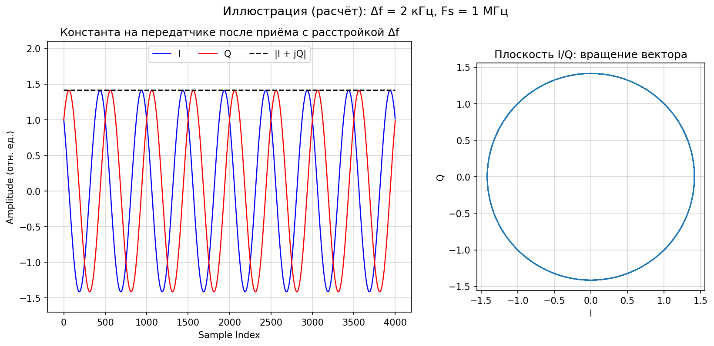

# Недели 4-6 (28.09 - 18.10): IQ-отсчёты, два Pluto

**Содержание**
* [Занятие 4. Приём IQ-отсчётов (29.09)](#занятие-4-приём-iq-отсчётов-2909)
* [Занятие 5. Среда и проект для двух Pluto (06.10)](#занятие-5-среда-и-проект-для-двух-pluto-0610)
* [Занятие 6. Приём и передача между двумя Pluto (13.10)](#занятие-6-приём-и-передача-между-двумя-pluto-1310)
* [Проблемы и решения](#проблемы-и-решения)
* [Запуск](#запуск)

---

## Занятие 4. Приём IQ-отсчётов (29.09)

**Задача:** принять IQ-отсчёты из буфера, записать в файл и построить график.

**Что сделал:** приём на 800 МГц, Fs 1 МГц, формат CS16, буфер 32768 отсчётов. Замерил RMS на 10 буферах при разном усилении, отсчёты записал в `.pcm` и построил графиком (`scripts/plot_original.py`).

| RX gain | RMS | Диапазон I/Q |
|---------|-----|--------------|
| 0 дБ | ≈ 0.02 | -1...1 |
| 40 дБ | ≈ 0.4 | -4...4 |

> **TODO (автору, уточнить):** в каких единицах RMS в этой таблице? Отсчёты CS16 — это int16
> (±32767), а «RMS ≈ 0.02 при диапазоне I/Q −1…1» читается только если значения нормированы
> на 32768. Указать нормировку явно (или привести сырые числа), иначе таблицу нельзя
> проверить. Заодно: при каком LO/ Fs / BW снималось и какой была температура/антенна —
> условия замера.

**Результат:** графики по порядку работы.

| Что видно | График |
|-----------|--------|
| Амплитуда упирается в предел int16 (около ±32 700) |  |
| Gain 0 дБ: только 0 и ±1, шумовой уровень |  |
| Gain 40 дБ: в основном ±1, выбросы до ±4 |  |
| Принятый сигнал: участки синусоиды и плотные пачки около ±200 |  |

<details>
<summary>Формула RMS</summary>

$$\text{RMS} = \sqrt{\frac{1}{N}\sum_{n=0}^{N-1}\left(I_n^2 + Q_n^2\right)}$$

</details>

---

## Занятие 5. Среда и проект для двух Pluto (06.10)

**Задача:** подключить два Pluto, один сделать приёмником, второй передатчиком.

**Что сделал:**
1. Среда: Bazzite, контейнер distrobox `sdr-build`. SoapySDR, libiio и SoapyPlutoSDR собраны из исходников.
2. Два Pluto по USB найдены через `SoapySDRUtil --find` (`usb:3.4.5`, `usb:3.5.5`).
3. Проект `pluto_dual` на CMake с тремя программами:

| Программа | Что делает |
|-----------|------------|
| `pluto_tx` | передаёт треугольный сигнал с таймстемпами |
| `pluto_rx` | принимает, пишет в `audio_rx.pcm` |
| `loopback` | проверка на одном устройстве |

**Результат:** передача и приём работают, все три программы собираются.

> **TODO (автору, обязательно):** исходников проекта `pluto_dual` (CMakeLists.txt и целей
> `pluto_tx`, `pluto_rx`, `loopback`) в репозитории НЕТ — в git попал только итоговый
> `src/main.c`. Отчёт ссылается на то, чего в репозитории нет. Либо (правильно) восстановить
> и закоммитить проект недели 5 отдельным каталогом/тегом, либо написать здесь честно:
> «проект остался в контейнере, был переработан в src/main.c, причины: …».
> Также добавить свой процесс: сколько попыток сборки было, что ломалось на двух платах
> до того, как всё поехало.

---

## Занятие 6. Приём и передача между двумя Pluto (13.10)

**Задача:** передать сигнал с одного Pluto на другой и принять его.

**Что сделал:** объединил программы в один бинарь [`src/main.c`](../../src/main.c) с режимом при запуске. Обе платы одновременно передают и принимают на разных частотах:

| Режим | TX | RX | Файл с записью |
|-------|----|----|----------------|
| `tx` | 800 МГц | 840 МГц | `rx_from_840.pcm` |
| `rx` | 840 МГц | 800 МГц | `rx_from_800.pcm` |

Параметры: Fs 1 МГц, TX gain 71 дБ, RX gain 60 дБ. Передаётся константа I = Q = 8000, то есть прямоугольный импульс в базовой полосе:

```c
const int16_t dc_val = 8000;
for (size_t i = 0; i < tx_mtu; i++) {
    tx_buf[2*i]     = dc_val;   // I
    tx_buf[2*i + 1] = dc_val;   // Q
}
```

Принятый файл (81 264 640 отсчётов) строится скриптом [`scripts/plot_iq.py`](../../scripts/plot_iq.py): I, Q и огибающая в окне 100 000 отсчётов из середины записи.

**Две версии передаваемого сигнала (важно для согласованности с кодом).**

| Версия | Что передаётся | Где в коде | Когда |
|---|---|---|---|
| A | константа `I = Q = 8000` (прямоугольный импульс в базовой полосе), код выше | ранняя версия `main.c` | занятие 6, графики ниже |
| B | тон 10 кГц, амплитуда 32000: `I = A·sin(2πft)`, `Q = A·cos(2πft)` | текущий [`src/main.c`](../../src/main.c): `tone_hz`, `amp` | после занятия |

> **TODO (автору, обязательно):** дописать наблюдения для версии B: что видно на приёмнике
> (частота биений, RMS, вид огибающей), приложить график `plot_iq.py --full-envelope` и
> пометить, какие из картинок ниже сняты на версии A, а какие на B. Сейчас графики и формула
> биений описывают версию A, а в репозитории лежит код версии B — без этого раздела текст
> противоречит коду. Заодно объяснить расхождение: почему решили уйти от константы к тону
> (постоянная составляющая? несущая утечка? проверка тракта?).

**Результат:** на графике IQ три пачки прямоугольных импульсов, которые ложатся на синусоиду. На ранней версии (gain 40/30 дБ) RMS на принимающей плате был около 260, на другой около 2.2.




**Почему синусоида.** Гетеродины двух плат стоят на чуть разных частотах. Из-за расстройки $\Delta f$ константа в базовой полосе на приёмнике вращается на частоте биений, а огибающая остаётся постоянной.

<details>
<summary>Диаграммы и формулы</summary>





$$r[n] = g\,A\,(1 + j)\,e^{\,j 2\pi \Delta f\, n / F_s}, \qquad I[n] = \sqrt{2}\,gA\cos\!\left(\frac{2\pi \Delta f\, n}{F_s} + \frac{\pi}{4}\right), \qquad |r[n]| = \sqrt{2}\,gA$$

Здесь $\Delta f = f_{TX} - f_{LO}$, $g$ учитывает потери в канале. Иллюстрация (расчёт, $\Delta f = 2$ кГц):



</details>

---


## Проблемы и решения

| Занятие | Ошибка | Причина и решение |
|---------|--------|-------------------|
| 5 | `timestamp_every only currently supported with direct mode` | нужен режим direct. Добавил в аргументы устройства `direct=1` |
| 5 | `'sqrt' was not declared` | не подключён `math.h`. Добавил `#include <math.h>` и ключ `-lm` |
| 5-6 | `Unable to claim interface ... Device or resource busy` | устройство занято прошлым запуском. `pkill -9 -f ./main`, пауза, повторный `--find` |
| 5-6 | `no device context found` | URI устарел, после переподключения он меняется (`usb:3.4.5` -> `usb:3.9.5`). Брал актуальный URI из `--find` |
| 6 | `jump to label crosses initialization` | переменные объявлены между `goto` и меткой. Переписал блок очистки |
| 6 | график 81 млн отсчётов строится очень долго | `plot_original.py` читал файл побайтово; переписал на `numpy.fromfile` и окно по записи (сейчас это `scripts/plot_iq.py`) |

---

## Запуск

Актуальная инструкция — в [BUILD.md](../../BUILD.md). Коротко:

```
cmake -S ../.. -B ../../build && cmake --build ../../build -j"$(nproc)"
# или одной командой: gcc ../../src/main.c -o ../../build/pluto_link $(pkg-config --cflags --libs SoapySDR) -lm
```

Два терминала (URI из `SoapySDRUtil --find`):

```
./build/pluto_link rx usb:3.x.5
./build/pluto_link tx usb:3.y.5
```

Остановка: Ctrl+C (при этом сохраняется `.pcm`). График:
`python3 scripts/plot_iq.py rx_from_800.pcm --save reports/assets/iq_rx800.png`.

Историческая справка: на занятии 6 собирал одной командой `g++ main.c -o main ...`
и запускал `./main rx|tx <uri>`; с тех пор код переехал в `src/main.c`, сборка — в CMake,
бинарь называется `pluto_link`.
